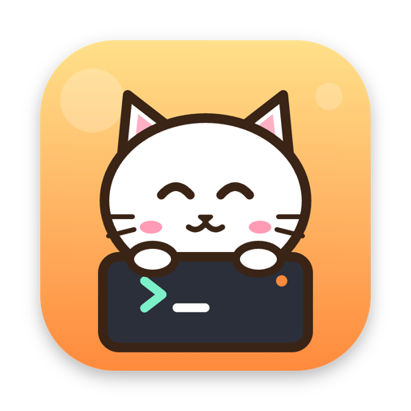
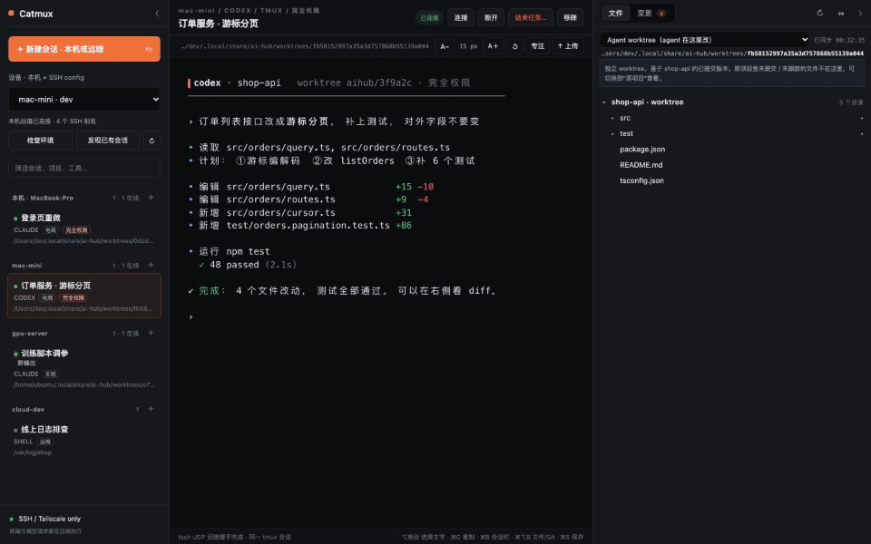
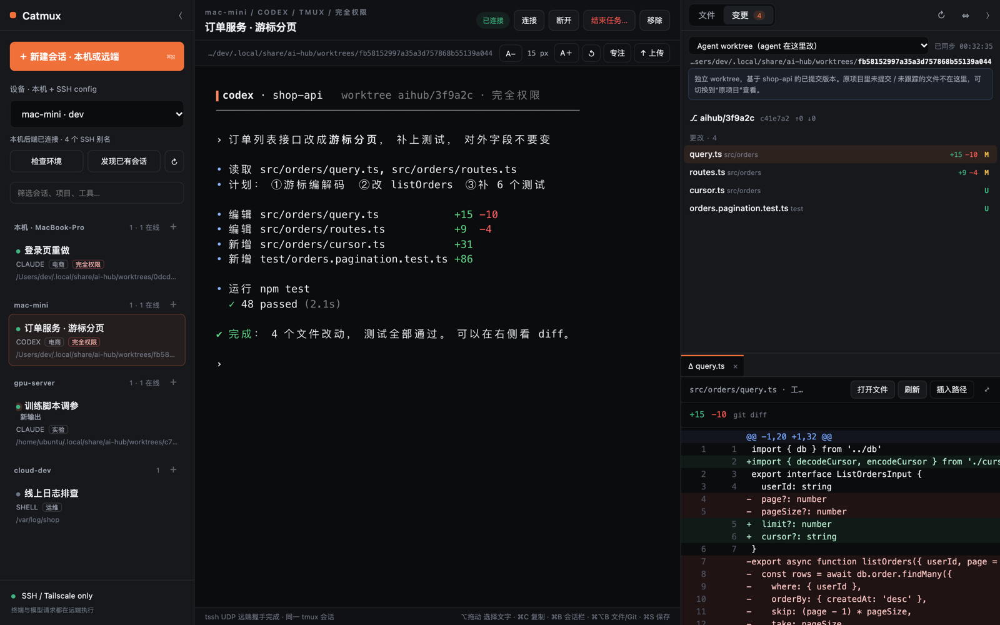
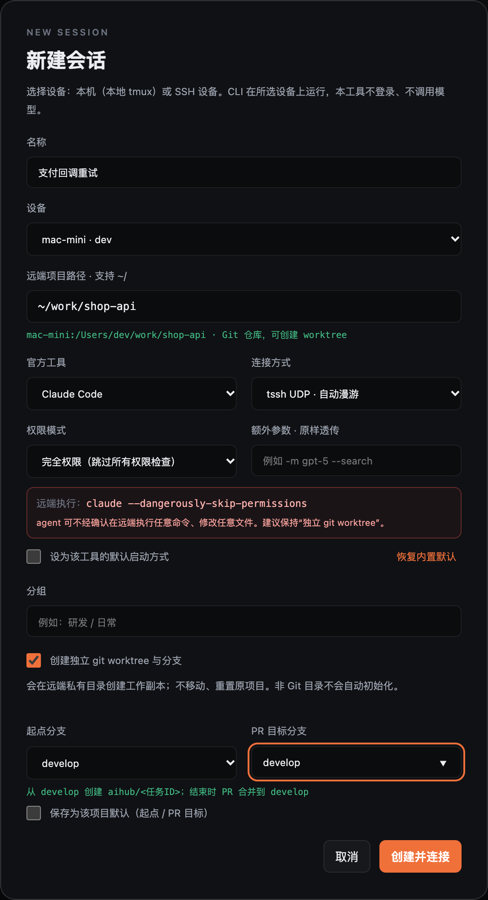
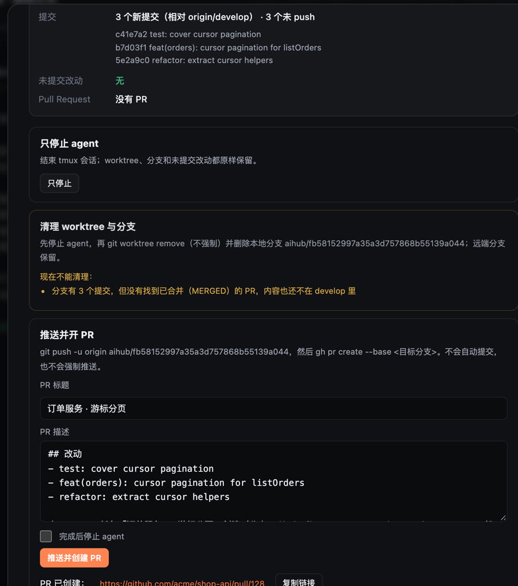
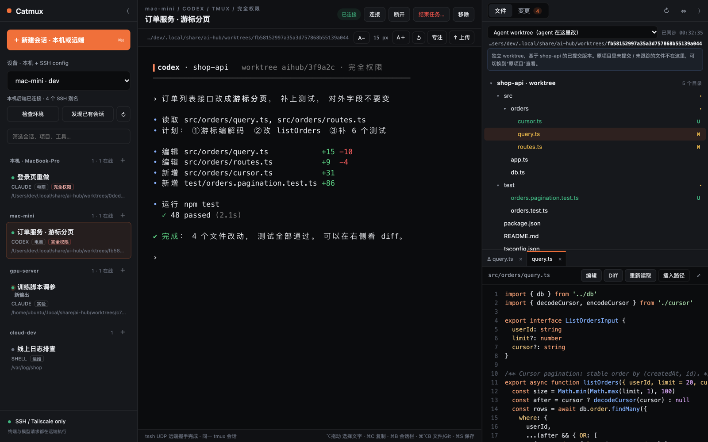

<p align="center">
  
</p>

<h1 align="center">Catmux</h1>

<p align="center">
  <b>远程的 Claude，本地的体验。</b><br>
  Claude Code / Codex 跑在你的服务器上，Mac 上一个窗口管住所有机器；合盖、断网回来，还是原来那一行。
</p>

<p align="center">
  
  
  
  
</p>

<p align="center">
  
</p>

```zsh
curl -fsSL https://raw.githubusercontent.com/lileilei2023/catmux/main/install.sh | bash
```

---

## 为什么做 Catmux

把 Claude Code 放到 Mac mini、GPU 机、云主机上跑很香：不占笔记本、合盖也不停。
但真这么用起来，每天都在忍这三件事：

| 痛点 | 用 Catmux |
|---|---|
| **远程用 Claude，不像在本机**：截图传不过去、复制不出来、看不到它改了哪些文件 | 粘贴截图自动传到那台服务器、插入远端路径；tmux 里复制的内容直达 Mac 剪贴板；不闪屏；右侧就是服务器上的文件树、编辑和逐文件 diff |
| **好几台服务器、十几个会话**，ssh 窗口切到崩溃 | `~/.ssh/config` 里的设备和本机排在左侧，一屏看全；Claude、Codex 都能管；后台会话有新输出会亮起来 |
| **一断线就慌**：合盖、换 Wi-Fi、刷新页面，任务还在不在？ | Claude 一直在服务器自己的 tmux 里跑，Catmux 只负责“看”；重连就回到**原来那个会话、原来那一行**，断多久都行 |

而且服务器上**什么都不用装**：只要 `tmux` 和 `python3`，用的就是原生 `claude` / `codex` 命令，不换启动方式、不装 wrapper、不经过任何中转服务器；已经在跑的 tmux 会话可以直接导入。

## 功能

### 断线不丢，回到原来那一行

- 每个会话都是那台设备上的一个 tmux 会话，关掉 Catmux、关掉浏览器、笔记本合盖，都不影响它在服务器上继续跑。
- 网络恢复后自动重连到**同一个**会话，画面和滚动历史都在；可选 `tssh` UDP 连接，换网络也不掉。
- 新建会话时选好设备和目录，或者把已有的 tmux 会话导入进来。

### 三栏工作台



- **左**：按设备分组的会话，`＋` 在任意设备上新建；右键连接、重命名、复制附着命令。
- **中**：真实的远端 tmux 终端（xterm.js），字体、专注模式、`⌘B` / `⌘⌥B` 随手收起两侧。
- **右**：远端项目的文件 / Git 变更，结构一次加载并缓存，刷新页面瞬间出现。

### 每个任务一个独立 worktree，收尾一键开 PR

<table>
<tr>
<td width="50%"></td>
<td width="50%"></td>
</tr>
<tr>
<td>新建任务：<code>~/</code> 路径补全、选起点分支（每个项目可设默认，比如 <code>develop</code>）、选权限模式（默认 / 自动编辑 / 完全权限）并可透传任意参数。</td>
<td>结束任务：先告诉你还有几个提交没 push、有没有未提交改动、PR 是否合并；推送并用 <code>gh</code> 开 PR，或在 PR 合并后清理 worktree 和分支。</td>
</tr>
</table>

- 清理只在**确认已合并**时才允许：GitHub 显示 PR 为 MERGED（兼容 squash），或 git 证明分支内容已进入目标分支（适用于 Gitee / GitLab / 本地合并）。
- 从不 `--force`，从不自动提交；有未提交改动会先列出来让你决定。
- 主仓库在外置盘而盘没挂上时，给出“磁盘未挂载”的明确提示，而不是一串 git 报错。

### 看得见 agent 在改什么



- 语法高亮预览、显式进入编辑、`⌘S` 保存；保存前校验远端版本，agent 同时改了就提示冲突，**绝不覆盖**；原文件私有备份。
- 可以切换浏览“Agent worktree / 原项目 / 跟随终端当前目录”。
- 图片直接预览；右键插入或复制远端绝对路径、scp 地址。

### 终端里那些细节

- **不闪烁**：tmux 以 `sync` 能力输出，前端按帧绘制。
- **能复制**：⌥ 拖动选择；tmux 复制模式经 OSC 52 直达 Mac 剪贴板；右键“复制最近输出 / 在右侧查看终端历史”。
- **鼠标不卡**：Claude Code 等开启的“鼠标移动上报”会被合并，不会把输入挤到排队。
- **能漫游**：可选 `tssh` UDP 连接，换网络、合盖回来接着用。

## 和其他方案有什么不同

| | Catmux | 官方 Remote Control | 手机端（如 Happy） | 本机并行工具（如 Conductor） | ssh + tmux |
|---|---|---|---|---|---|
| 会话跑在哪 | 你的任意服务器 | 开着终端的那台机器 | 运行 wrapper 的机器 | 本机 | 服务器 |
| 多台服务器一屏管 | ✅ | — | — | — | — |
| 断线后回到原会话 | ✅ 无超时 | 断网约 10 分钟超时 | ✅ | — | ✅ 需手动 attach |
| 服务器上要装什么 | `tmux` + `python3` | Claude Code 自带 | wrapper + 同步服务器 | — | `tmux` |
| 远端文件树 / diff / 截图上传 | ✅ | — | — | 仅本机 | — |
| 手机上用 | — | ✅ | ✅ | — | 用 SSH App |

Catmux 定位是**桌面上的主力工作台**，不是手机遥控器；想在手机上看一眼，可以和上面的工具一起用，互不冲突。

## 安装

```zsh
curl -fsSL https://raw.githubusercontent.com/lileilei2023/catmux/main/install.sh | bash
```

访问不了 `raw.githubusercontent.com`（国内网络常见）时，用 git 克隆后运行安装脚本，效果相同：

```zsh
git clone git@github.com:lileilei2023/catmux.git ~/.local/share/catmux/app
~/.local/share/catmux/app/install.sh
```

- 需要 Node.js ≥ 18、`python3`、`git`、`ssh`。**不需要 `npm install`**，前端依赖随仓库提供。
- 可选：`tmux`（使用“本机”设备）、`tssh`（`brew install trzsz-ssh`，UDP 漫游）、`gh`（查 PR / 开 PR）。
- **远端设备什么都不用装**，只要有 `tmux` 和 `python3`。

装好之后：

```zsh
catmux open                 # 启动并打开窗口（也可以双击 应用程序 → Catmux，或固定到 Dock）
catmux status | logs        # 状态 / 日志
catmux update               # 更新到最新版
catmux autostart on|off     # 登录后自动启动（默认关）
catmux icon cat|robot|cloud|classic
catmux doctor               # 检查依赖
catmux uninstall            # 移除命令 / 服务 / 启动器（不动数据与各设备上的会话）
```

在 Chrome 打开 <http://127.0.0.1:48731> 后点地址栏右侧“安装”，就是一个独立窗口的 App。

## 安全设计

- 只监听本机 `127.0.0.1`，带 CSRF / Origin 校验；页面不能执行任意命令。
- 所有远端操作走普通 SSH：严格主机密钥校验、不转发任何东西；同一设备复用一条连接。
- 远端用到的协议脚本按 SHA-256 缓存在 `~/.local/share/ai-hub/agent/`，**每次执行前校验哈希**，被改过就重新下发、绝不执行。
- 不读取任何模型配置、登录状态或对话记录；停止只结束对应的 tmux 会话。

## 常见问题

**会影响 Codex / Claude 账号的风控吗？**
Catmux 不代理、也不发起任何模型请求。CLI 就运行在你选的那台设备上，模型请求从那台设备、以它原本的网络发出，和你直接 ssh 上去运行没有区别。

**和直接 ssh + tmux 有什么区别？**
底层就是 ssh + tmux，所以会话和你手动 attach 的是同一个。Catmux 加上的是：多设备一屏管理、断线自动重连到同一会话、远端文件 / diff / 编辑、任务 worktree 与 PR 收尾、截图上传、复制与不闪烁这些体验。

**支持 Linux 远端吗？**
支持，远端只需要 `tmux` 和 `python3`（macOS 用 `zsh -lc`，Linux 用 `bash -lc`）。Catmux 本身目前只在 macOS 上安装。

**会话名为什么是 `aihub-…`？**
Catmux 的前身叫 AI Hub。为了让升级前创建的会话、任务分支（`aihub/<id>`）和设备上的目录继续可用，这些内部名字保持不变。

## 开发

```zsh
npm test                                    # 单元测试：真实 git / tmux / Python，远端在本机模拟
npm run test:web                            # 真实 Chrome 端到端（需要 Playwright；远端为模拟）
CATMUX_LIVE_HOST=<ssh 别名> npm run test:live   # 对真实设备的只读检查
```

截图与宣传视频都来自演示模式下的真实界面（数据全部虚构）：`node promo/capture.js` 截图，`promo/video` 是 Remotion 项目。

第三方前端文件（xterm.js、highlight.js）的许可证见 [`web/vendor/LICENSES.md`](web/vendor/LICENSES.md)。

## 许可证

MIT，见 [LICENSE](LICENSE)。
